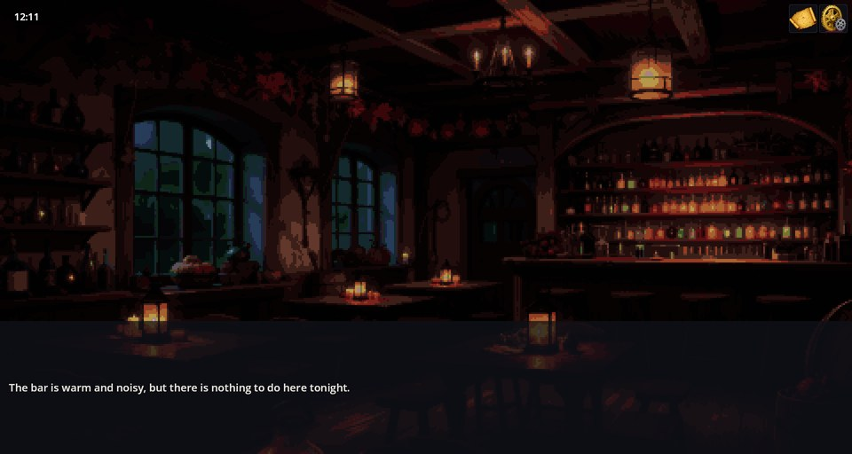
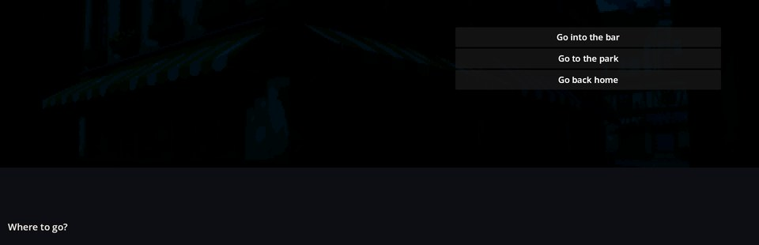

# My Novel — 你自己的视觉小说起点

My Novel 是项目中最小的完整视觉小说：傍晚的小镇、一家酒吧和一处住宅，由选项连接起来。它没有角色、物品和战斗——只有场景、简短的剧本文件和它们的翻译。它生来就是供人复制的：改个名字，然后从这三个地点生长出你自己的故事。

从“开始游戏 → My Novel → 新游戏”进入。它是 **My Novel** 游戏（合集 `novel_template`）的内容。



## 里面有什么

```filestree
my_novel_game/
├── manifest.json
├── scenes/
│   ├── my_novel_town.json      城镇入口，游戏从这里开始
│   ├── my_novel_bar.json       酒吧，带自己的环境音
│   └── my_novel_home.json      住宅门厅
├── scenarios/
│   ├── my_novel_town.scenario
│   ├── my_novel_bar.scenario
│   └── my_novel_home.scenario
└── locale/
    ├── en.properties           模组名称和描述
    └── scenarios_<lang>.properties   剧本各行的翻译
```

图片和酒吧的环境音都不在这个模组里：它们来自 **Town Pack**，这样模板才保持小巧，也示范了游戏如何复用共享内容。音乐来自 **Music Pack**；引擎模组是 2D 外壳、对话引擎和音频引擎。

## 故事的流向

小镇是枢纽。每次到访都显示同样的选择；酒吧和住宅各自通向返回的路。

```text
            ┌────────────────────┐
            │   my_novel_town    │  （起点）
            │     “去哪儿？”      │
            └──┬──────────────┬──┘
       走进酒吧              回家
               ▼              ▼
     ┌──────────────┐  ┌──────────────┐
     │ my_novel_bar │  │ my_novel_home│
     └──────┬───────┘  └──────┬───────┘
            └─ 回到小镇 ─┘
```


场景文件写明背景和环境音：

```json
{
  "name": "my_novel_bar",
  "defaultBackground": "bar/bar",
  "defaultAmbient": "bar/bar_ambient"
}
```

与场景同名的剧本会在进入该场景时运行：

```scenario
scene: my_novel_town
priority: 10
---
# The town is the hub: every visit shows the same choice.
text "Evening town. The street lamps are already lit and a cool draught runs along the cobbles." key=my_novel/town/intro
select "Where to go?" key=my_novel/town/prompt
option "Go into the bar" key=my_novel/town/opt_bar -> :bar
option "Go back home" key=my_novel/town/opt_home -> :home

:bar
switch_scene my_novel_bar
end

:home
switch_scene my_novel_home
end
```

英文文本直接写在剧本里。每个 `key=` 指向该行在 `locale/scenarios_<lang>.properties` 中的翻译，比如西班牙语：

```properties
my_novel/town/intro = La ciudad al anochecer. Las farolas ya están encendidas y una corriente fresca recorre los adoquines.
```

## 把它变成你的

1. **复制并重命名模组。** 用你的游戏名加 `_game` 后缀命名，例如 `harbor_game`。把文件夹名和 `manifest.json` 里的 `id` 改成同一个值，并把 `locale/*.properties` 中的键 `mod_my_novel_game_name` / `_desc` 改成 `mod_harbor_game_name` / `_desc`。
2. **为它建一个游戏。** 在 **Mods & Collections → 合集** 中打开 My Novel 的结构并按 **复制**，然后在“故事”分组里把 `my_novel_game` 换成你的模组。入口场景在合集中设置（`"entry": { "scene": "my_novel_town" }`）。
3. **按需重命名场景：** 场景的 `name`、它的文件、其剧本的 `scene:` 头以及每一个通向它的 `switch_scene` 都必须一致。
4. **保留或替换美术。** 想保留小镇，就把 `town_pack` 留在 `depends` 里；或者添加自己的 `backgrounds/` 和 `sounds/`，并让 `defaultBackground` / `defaultAmbient` 指向它们。

## 第一处修改：添加一个地点

这是一次真实的编辑器操作，在 My Novel 里加入 Editor Tools 模组后进行。场景编辑器创建了 `my_novel_park` 场景，再在小镇剧本里敲入一个选项和一个标签：


```scenario
option "Go to the park" -> :park

:park
switch_scene my_novel_park
end
```

保存之后，小镇立刻给出新的去路，选择它就会打开新场景：



想在自己的游戏里用上编辑器，可以在结构中加入 **Editor Tools** 模组，或者带着它们启动一次游戏：

```text
godot --path . -- --game=novel_template --new --with-mods=editor_tools
```

没有 `key=` 的新行在任何语言下都显示字面文本；等故事准备好翻译时，再加键和译文。

## 如果不奏效

1. **某个选择哪儿也到不了。** `switch_scene` 的名字必须等于目标场景的 `name`，大小写也要一致。
2. **某个场景没有文本。** 它剧本的 `scene:` 头必须写这个场景的名字。
3. **别的语言下文本是英文。** 这一行没有 `key=`，或者该语言的 `scenarios_<lang>.properties` 里缺这个键。
4. **背景全黑。** 背景名字拼错了，或者拥有这张图的模组不在 `depends` 里。
